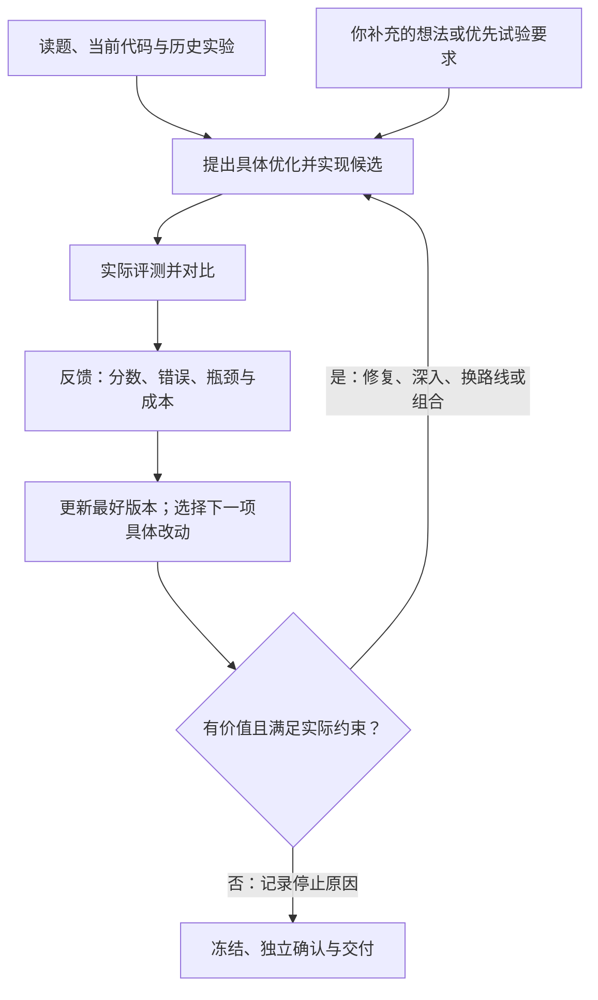

# Competition Agent Skill

一个以分数最大化为目标的竞赛优化流程：Codex 结合你的想法、当前代码与历史实验提出下一项具体优化，实现候选、实际评测，再更新判断。优化请求应交付代码、实测对比和可复现产物。

当前仓库包含通用的 `competition-optimize` 控制流程、固定时隙 C++ 评测 adapter，以及通用预测 CSV 评测、比较、抽样不确定性估计、错误诊断和固定权重集成工具。核心流程面向不同竞赛题型；每项任务仍需核对其规则、指标和验证协议。比赛源代码、二进制和评测结果不会被复制到本仓库。

## 最小版本

架构是 **一个通用 Codex skill + 按题型扩展的评测适配器**；薄型 runner 等重复操作确实造成错误后再决定：

- **Skill**：指导 Codex 固定官方目标、定向检索、建立 baseline，先比较不同解题路线，再实施完整方法替换或深入有潜力的机制，并按官方指标分析反馈。
- **比赛适配器**：提供题型专属的候选接口、硬约束、评测和官方评分计算；当前有算法/代码 adapter，以及预测 CSV 的 RMSE、MAE、二分类 LogLoss 和 ROC-AUC 评测层。可按独立样本或完整组估计固定预测的抽样不确定性，诊断开发集误差与分组退步，生成加权集成候选，并将冻结配方复用于确认集或测试集。数据准备、训练、防泄漏和资源验证仍需按比赛接入。
- **可选薄型 runner**：只在手工 pilot 出现快照、超时或记录错误后，实现候选隔离和结构化记账；不实现搜索算法或通用沙箱平台。

候选档案工具 [`candidate_archive.py`](skills/competition-optimize/scripts/candidate_archive.py) 提供评测前重复检查、JSONL 追加记录与紧凑历史摘要。它根据同契约开发结果、路线历史最好成绩和有依据的未解决机会输出继续、换路线或诊断建议；确认集不会改变优化建议，必要复测需说明原因。官方分数、下一项具体实现与晋升仍由 adapter 和 agent 按题目规则决定。

现在还能[把提案连到实际执行结果](skills/competition-optimize/references/iteration-trace.md)：agent 先引用父版本代码和开发反馈提出具体改动，再把新评测结果、观察和预测是否成立接回提案。`trace` 明确区分待执行、已评测和已停止，拒绝用旧结果、未改流水线或确认反馈冒充一次优化。默认只展开最近八项，保留全部待执行 ID，恢复任务时不用重读所有历史。

新增只读的 [`brief` 入口](skills/competition-optimize/references/iteration-trace.md#retrieve-evidence-for-the-next-implementation)，一次取回同口径历史最好代码、最近失败反馈、备选路线及未完成提案。最好版本不受近期退步影响，备选按实测目标排列，重复测量不能靠幸运高分或改路线名制造新代表。agent 随后直接读相关代码、提出并实施改动，无需增加一份记录。

进一步区分实现与产物：同训练流水线的随机预测差异会保留为多次测量，不能制造新方法或路线进步；算法源码改动可沿用原配置。缺少训练代码的旧预测保留分数并标出证据缺口，输出文件也不能冒充代码优化目标。

完整 221 项测试通过。受控实际拟合和程序执行复现并修正了上述误判；旧档案无需迁移，未增加记录参数。此前 `brief` 首版在三组既有记录的回放中比默认摘要少输出约 27%–51% 的字符，减少来自重复元数据及确认记录。以上检查尚未证明真实比赛提分或完整 agent 提速，详见[效率记录](docs/efficiency.md#区分真实实现改动与随机输出差异)。

核心循环不依赖题型，但搜索策略和验证方式由 adapter 提供。没有可靠评测器时，先建立并验证评测器，不进入昂贵搜索；尚未实现 adapter 的题型不能宣称已支持自动优化。

## 工作流程

1. **新建或恢复**：读取题目、当前实现和近期结果，核对未完成实验，复用依赖匹配的评测器与 baseline；固定指标、硬规则、开发和确认协议。预算记录来源与作用范围，保留历史消耗。
2. **核验评测器**：新建或口径变化时用已知正反例核对评分；已有匹配评测器沿用原证据。区分本地官方指标、平台回执与代理指标。
3. **检索与 baseline**：复用依赖匹配的可信 baseline；缺少可执行假设时按指标、规模、规则和瓶颈检索，将来源转成有适用条件和验证办法的实验。
4. **高效提出并实施优化**：结合你的想法，用一次有边界的侦察检查当前源码关键路径、相关成功/失败版本和评测身份；找到可验证的机制后立即提出具体改动，说明代码位置、想法来源、历史依据、与失败尝试的区别和验证办法。维护候选档案和失败机制索引，拦截重复改动；尊重明确的试验优先级，其他方案根据证据在继续当前路线和切换路线之间选择。通过接口、硬规则、产物和评测一致性质量门后实施；必要的表示、预处理或搜索组件一起测试。默认不安排参数搜索。
5. **反馈决定下一次实现**：实际编译、训练或执行，与父版本和当前最好版本比较有效性、完整目标及成本。判断预测是否成立，分别决定是否晋升和是否继续投入；将本次证据接到具体的下一项代码/流水线改动，返回第 4 步实际运行。单次低分不会自动结束优化，后续试验之间不等待用户再次提示。
6. **确认与交付**：用户停止、实际约束阻止继续或没有可信有价值的下一步时，冻结候选并独立确认，输出方案、提交包和迭代链：实测结果 → 反馈决定 → 已实施的后继改动 → 新结果或停止原因。未运行的建议明确标为待执行。

第 4–5 步持续反复执行，具体反馈分支见 [score-search.md](skills/competition-optimize/references/score-search.md#close-the-feedback-loop)：

## 提供你的想法

开始时或 agent 正在迭代时，直接用自然语言补充即可。例如：

> $competition-optimize 继续优化。我怀疑当前只做两两交换容易卡住，优先实现一次多位置重排，与当前最好版本按相同评测口径比较。

> 我觉得错误可能与时间有关，这个想法供参考。结合当前特征、数据划分和历史结果判断，值得就实现验证，否则说明原因。

> 先讨论这个想法，暂时不要改代码：能否把两条路线按输入特征组合起来？

Agent 会保留你的原意，区分建议、优先试验和明确要求，把想法接到具体代码位置、假设及验证办法。一般建议参与下一步方案选择；明确要求试验时优先执行可行方案。遇到影响实现的歧义才定向澄清，常规细节说明假设后继续。

反馈包含“你的想法 → 实际实现的解释 → 候选与实测对比 → 下一步”。未验证的想法会标为待执行或说明推迟原因，已有类似失败会引用历史证据。新想法不会清空已测结果或重新开始整个流程。处理规则见 [用户想法接入](skills/competition-optimize/references/score-search.md#turn-user-ideas-into-experiments)。

## 关键约定

- 按官方指标决定候选，明确越大越好或越小越好；缺少评分参数时保留分项和 Pareto 候选，代理指标只用于暂定搜索。
- 不设置默认的时间、计算、候选数量或轮次数额。记录每个 baseline、失败实现、修复版本和复测的实际消耗，利用反馈持续实施下一项有价值的优化；只有比赛硬规则、实际资源条件或用户当前明确的限制会停止搜索。
- 用户取消或调整限制后，从后续决策开始按新范围继续，保留累计记录和已消耗资源；不把历史 skill 默认值当成仍然有效的额度，也不要求通过“再开一轮”获得许可。
- 不将自定的最小收益、最大减速或与 incumbent 完全相同的输出当成比赛要求；等价加速可检查输出一致性，其他有效解按实际目标比较。
- 默认由 agent 结合用户想法、代码和历史推导下一步，直接实施验证；不自动做网格、随机、贝叶斯或邻近值扫描。用户明确要求调参时才开启专门的参数搜索。
- 先做一次有边界的代码/历史侦察，证据足够就停止阅读并实施；不遍历无关日志。候选先过接口、硬规则、评测身份、产物可复现和目标口径质量门，再进入昂贵评测。
- 持续维护 incumbent、runner-up、不同路线代表、待验证候选和失败机制；新候选必须有指纹和父版本，近重复改动需要新证据。连续弱结果时切换表示、模型、邻域、数据或策略，不用便宜小改耗尽可用资源。
- 优化期间保持评测口径一致；评测器变化后，重新评测需要比较的版本。
- 保留独立验证场景，用于检查最终候选的泛化表现。
- 每次实验记录父版本、假设、代码快照、配置、指标、耗时、状态和失败原因。
- 最好版本与最新版本分别保存，失败实验不覆盖已验证的方案。
- 输出提交包；正式提交按用户授权和比赛配额处理。

## 源码研究结论

- 从 AIDE 借鉴父子候选记录、先产生 baseline 和一次只提出一个可检验改进的做法。
- 从 ShinkaEvolve 借鉴窄范围可变代码区、非 Python 评测适配和结构化正确性结果。
- 将 AIDE 式搜索选择与 Shinka 式评测/检查能力组合成一个轻量闭环；第一版不引入外部进化框架或多 agent 群组。
- Meta 的 LLM Speedrunner 是更贴近算法优化的参照：阶段化假设、实现、执行、分析，版本化工作区记录候选历史。其完整实验框架与 GPU/Slurm 配置不纳入 MVP。
- MLEvolve 的停滞检测、跨分支经验值得后续验证；其 MCGS、多 agent、embedding memory 和 Kaggle 数据栈不作为首版依赖。
- FDE-Bench 的离子束均匀性 case 是“优化/均匀性”表述上的近邻，但实际任务是预测曲线；只参考任务澄清和 evaluator 设计。case 数据和实现没有开放再分发许可，不复制进本仓库。
- 评分器以程序输出为准；测试失败、耗时和多项指标都作为单独证据。模型的解释用于选择下一项实验，不直接决定候选分数。
- 保留可运行的最好版本，并用固定测试集配对比较；在用户停止、实际约束或没有可信后继时停止。

完整的源码依据、竞品取舍和首版接口草案见 [`docs/research.md`](docs/research.md)。

新增流程借鉴 MLE-STAR 的搜索与组件内优化、ReEvo 的候选对照学习、ALE-Agent 的表示和邻域搜索，以及获奖选手的验证与互补集成经验。具体来源和适用条件见[补充研究](docs/automation-and-solving-experience.md)；按题型选择实验时读取 [task-playbooks.md](skills/competition-optimize/references/task-playbooks.md)。这些是已写入 skill 的决策方法，提分效果仍需跨任务对照验证。

## 验证边界与历史案例

2026-10-10 的实际使用中，用户反馈“只分析或小改，没有实质推进”。复核发现两轮共运行 9 个变体，但多数仍围绕同一优化器微调，且反复受额度询问、自定速度门槛和缺失评分参数影响，没有产生更强发布版。本次据此重写执行入口、移除人为默认额度、纠正代理门槛和路线分类；详见[实际使用复盘](docs/execution-first-revision.md)。此次为指令和文档修正，尚未经过新版的完整 agent 实战验证。

已使用华为云固定时隙均匀调度算法题验证 adapter，覆盖 C++ 函数接口、在线增删操作、均匀性与稳定性权衡、运行时间，以及禁止乘除、取余和浮点运算的限制。

现有比赛材料与解法留在原工作区。算法 adapter 已有 11 项单元测试及真实 smoke/full 运行验证；预测 CSV 工具新增指标、样本对齐、异常输入、评测契约比较及 CLI 测试。

另已完成两个公开真实数据集的[受限表格 pilot](docs/tabular-pilot.md)，串联训练、诊断、冻结组合与独立确认，并与 sklearn 独立计分核对。回归组合在本次确认集有约 0.54% 的 RMSE 改善，但区间跨零；分类出现开发/确认排名反转。该结果已用于加强 loader 防泄漏审查、排名稳定性判断和预先声明的确认决策。它是预设脚本的集成验证，跨任务自主提分能力仍待独立对照。

已做[效率优化与对照](docs/efficiency.md)：入口按决策需要加载参考，复用匹配的中间结果；bootstrap 缓存损失与 AUC 排序，在八项计时中约提速 1.9–7.4 倍，逐次结果与旧实现一致。该性能比例只描述抽样评测，不代表完整比赛流程提速。

主流程现已加强[路线选择与较大候选替换](docs/route-search-pilot.md)：先比较解题路线，再深入表示、算法、训练信号或策略，收益饱和时重新选择路线。候选可以替换完整耦合流水线。算法端到端示例中，两组各六个候选名额，路线组冻结方案在新 seed 的 12 个确认实例上平均路径长度降低约 17.3%，参数组未超过 baseline；路线组使用更多计算。这是预设合成任务的说明性对照，不能作为自主 agent 或真实比赛提分的证明。

继续投入时新增[弱结果诊断与完整路线对照](docs/route-search-pilot.md#弱结果之后怎样投入)：不把低分或工作上限直接解释为整个方法失败，也不给每条路线自动追加试验。本次固定协议中，较弱构造接上完整搜索后明显改善，但仍未胜过第一名，两组选择相同；全面探索用了更多计算。结果支持有证据的投入判断，未证明新增流程提分。

进一步将[实验反馈接到下一项可执行改动](docs/route-search-pilot.md#让反馈改变下一项实验)：先记录预测是否得到支持，再限定解释与迁移条件。三个候选的条件脚本试验中，上限附近仍在改善的证据触发搜索顺序改动；较弱路线开发长度降低约 3.36%，仍未超过最好方案，因此保留 baseline。这个收益未独立确认，也不是自主 agent 生成方法的效果证明。

错误分析可用 [`--summary-only`](skills/competition-optimize/references/data-model.md#diagnose-development-errors)保留全样本核验、分组摘要和最差案例，按需导出完整逐例表。50,000 行 RMSE 对照中，摘要诊断约提速 1.89 倍，Python 分配峰值从 66.5 MB 降到 35.3 MB；两项真实数据的 6 个候选对照诊断一致，默认完整导出字节不变。

决定是否尝试两模型组合时，可按需增加 [`--check-blend-direction`](skills/competition-optimize/references/data-model.md#check-whether-a-two-parent-blend-has-a-useful-direction)：对 RMSE/MAE 检查目标函数方向，排除无法严格超过最好单体的理想凸组合，并识别较弱模型可能提供的组合价值。它不选择权重或给出组合分数；每个实际测试的配方仍计一次 trial，其他指标需另作判断。已通过 144 项测试和两题集成复跑，尚未证明完整 agent 的试验节省或提分效果。

新增同契约预测的[批量评测入口](skills/competition-optimize/references/data-model.md#batch-ready-candidates)：单进程顺序评分、独立候选证据和可选基线比较。两项 CLI 对照约提速 4.5–5 倍；12 份既有真实数据预测的分数、hash 与契约一致，未重训模型。批量数量不改变试验预算，确认只处理冻结候选。

候选档案工具已用 23 个行为测试覆盖重复拦截、训练前流水线检查、父版本、无效反馈、口径变化、停滞判断、中断恢复与确认隔离，并回放两项真实数据 pilot 的 12 份既有结果，保留原分数、hash 和检查范围。未重新训练或执行新比赛候选；自主提分与节省试验的效果仍需实战验证。

流程新增[决策卡与恢复路由](skills/competition-optimize/references/decision-loop.md)：继续任务只补读变化的事件和当前决策所需证据，实验完成但未记账时先核对产物，候选预算耗尽后进入冻结确认。只读的 `inspect_run_resume.py` 自动核验契约/日志检查点，分页返回新增事件，拒绝损坏记录，检查点仅覆盖本页事件。已对两个真实 pilot 的历史记录做回放核对，保留原交付规则与预算；这不代表完整 agent 的提分或耗时对照。

复用预测缓存时，可给[比较命令](skills/competition-optimize/references/data-model.md#compare-local-scores)增加 `--truth`，核验标签/预测字节及安装中的 evaluator，并重算保存的分数，输出独立核验回执。快速比较继续保留；评分口径变化时仅重做受影响的评测，数据或训练变化时另核对拟合来源。

训练前可用[数据划分检查](skills/competition-optimize/references/validation-split.md)核对 ID 重叠，并按协议检查分组隔离、时间边界与标签可用时间。回执可在依赖一致时复用，避免逐模型重复检查；它核验声明的划分记录，实际拟合与上游预处理仍需另查。

使用便宜评测淘汰候选前，可用[筛选校准工具](skills/competition-optimize/references/screening.md)检查参考候选的排序反转，以及按计划保留数量会漏掉哪些完整开发评测最优候选。支持两阶段各自的指标方向与并列容差，适用于配对标量分数；分数与候选关联由 adapter 核验，筛选不能替代完整评测。

## 参考项目

| 项目 | 参考重点 |
| --- | --- |
| [LLM Speedrunner](https://github.com/facebookresearch/llm-speedrunner) | 算法/代码优化实验循环、版本化工作区；最贴近本项目目标。 |
| [AIDE](https://github.com/WecoAI/aideml) | 候选代码搜索树，以及生成、修复和改进之间的选择。 |
| [AutoKaggle](https://github.com/multimodal-art-projection/AutoKaggle) | 读题、规划、开发、评审和总结的竞赛流程。 |
| [MLEvolve](https://github.com/InternScience/MLEvolve) | Kaggle 与数学优化上的进化搜索；借鉴停滞识别与多分支保留，不搬完整框架。 |
| [ShinkaEvolve](https://github.com/SakanaAI/ShinkaEvolve) | 程序演化，以及已有的 Codex / Claude skill 组织方式。 |
| [OpenEvolve](https://github.com/algorithmicsuperintelligence/openevolve) | 初始程序与自定义评测器驱动的代码优化。 |
| [MLE-bench](https://github.com/openai/mle-bench) | 参赛 agent 的评估方法与比赛评测适配。 |
| [FDE-Bench](https://github.com/baidubce/FM-Agent/tree/main/FDE-Bench) | 端到端交付与 evaluator 设计；case 006 是曲线预测任务，不是时隙调度。 |
| [AI Scientist v2](https://github.com/SakanaAI/AI-Scientist-v2) | 研究型树搜索和代码隔离风险提示；仅作概念参考。 |

## 下一步

按 [`docs/mvp-plan.md`](docs/mvp-plan.md) 了解当前实现边界。通用流程见 [`skills/competition-optimize/SKILL.md`](skills/competition-optimize/SKILL.md)，固定时隙计分限制见 [`fixed-timeslot.md`](skills/competition-optimize/references/fixed-timeslot.md)，预测 CSV 评测用法见 [`data-model.md`](skills/competition-optimize/references/data-model.md)。新增题型先遵守 [`adapter-contract.md`](skills/competition-optimize/references/adapter-contract.md)；当前没有完整的 Kaggle 数据准备、训练和提交集成。
