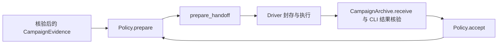

# Campaign 每轮决策

长期驱动将每轮的工作选择、上下文刷新和成功交付确认集中在
[campaign_policy.py](../skills/competition-optimize/scripts/campaign_policy.py)。
Driver 继续持有进程、锁、请求封存和持久化顺序；档案文件的读取、核验和接收
由 [CampaignArchive](campaign-archive.md) 负责。

## Policy Interface

`CampaignPolicy.prepare(memory, evidence)` 返回 `TurnPlan`：待保存的状态更新、
是否使用新上下文、刷新原因和请求的 review。调用不改变 memory 或 evidence。

工作选择依次考虑执行修复、已有固定测量计划、比较缺口、重复测量冲突、
目标停滞，以及 receipt/空转请求的后继。随后独立决定上下文轮换。
`measure` 和 `repair` 来自当前证据；计划关闭或执行恢复后，不继承失效模式。

`CampaignPolicy.accept(memory, sealed_turn, outcome)` 返回状态更新和下一步预览。
`TurnOutcome` 包含核验后的证据视图、本轮新增事件、档案计数增量、成功 receipt
或 `None`，以及调用方提供的时间。Policy 不读取文件、启动进程或读取系统时钟。

接收核验后的实验记录与确认交付是两件事。即使 CLI 随后失败，合法追加仍可
进入证据；成功会话计数、曝光和 review 只在成功 receipt 后推进。确认 comparison
review 后，先按新的 checkpoint 派生 continuity，再选择后续工作。

`next_mode` 是下一步预览，不创建新轮次、不确认新 review，也不增加轮换计数。
Agent 的 complete/blocked receipt 仍是后续规划输入；停止和完成验证由 Driver 负责。

## Handoff Interface

[campaign_search.py](../skills/competition-optimize/scripts/campaign_search.py) 的
`prepare_handoff(memory, prepared, evidence, task_sha256)` 同时返回 `packet` 和
`delivery`。后者只包含最终裁剪后仍完整、核验过的检索材料，并编码为已有的
`frontier_exposure`、`pending_proposal_exposure`、`trial_exposure`、
`learning_exposure` 和 `review_checkpoints` 字段。

Policy 请求 review；Handoff 判断所需材料是否实际交付；Policy 在成功后确认原封存
意图。Driver 将两者封存，不再逐类理解卡片。独立调用 `handoff_packet` 保留原返回形状。

## Evidence Interface 与恢复

`CampaignArchive.confirmed` 在构造交接材料前后核对同一前缀；`receive` 返回
合法新增事件和计数变化；启动及无在途轮次恢复通过 `verified` 核验全量文件。
CLI 失败与合法档案接收独立，文件隔离规则见[档案接收说明](campaign-archive.md)。

`CampaignEvidence(records)` 借用一个已核验档案前缀。`signals(checkpoint)` 和
`counts` 不读文件，共用比较投影和派生结果；checkpoint 改变时按该 checkpoint
返回 continuity。交接核验共用该视图内的
[`EvidenceReads`](../skills/competition-optimize/scripts/evidence_files.py)。比较投影
与文件核验的依赖方向见[候选证据说明](candidate-evidence.md)。

视图存活期间不修改 records。接收新前缀或准备另一个轮次时创建新视图，使结果及
源码字节继续按原规则复核。缓存只在内存中存在。

schema-v2、档案 JSONL 和 CLI 保持现有格式。Driver 先保存完整意图，再物化请求和
启动进程；恢复使用原请求及原交付字段，缺少旧可选字段时不补造交付。
核验结束后应用 Policy 更新，并沿用原有事件和状态保存顺序。
