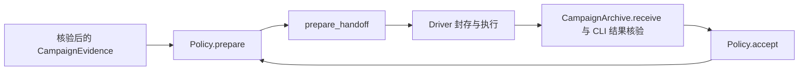

# Campaign 每轮决策

2026-11-10 更新：Policy 仍保持纯决策。Driver 的封存/接收顺序由 `TurnLifecycle` 承担，schema-v2 默认值由 `campaign_state` 统一。`campaign_handoff` 选择完整证据卡，`campaign_prompt` 按 mode/实际证据生成说明；`campaign_workflow` 冻结真实指令 package。新来源信息不改变候选比较身份，[运行与兼容说明](../skills/competition-optimize/references/unattended-campaign.md)。

长期驱动将每轮的工作选择、上下文刷新和成功交付确认集中在
[campaign_policy.py](../skills/competition-optimize/scripts/campaign_policy.py)。
Driver 继续持有进程、锁、请求封存和持久化顺序；档案文件的读取、核验和接收
由 [CampaignArchive](campaign-archive.md) 负责。

## Policy Interface

`CampaignPolicy.prepare(memory, evidence)` 返回 `TurnPlan`：待保存的状态更新、
是否使用新上下文、刷新原因、请求的 review 及可选的 `driver_action`。调用不改变 memory 或 evidence。

工作选择依次考虑执行修复、已有固定测量计划、已请求的本地交付、比较缺口、重复测量冲突、
到期或已排定的策略审查、已选定的实施提案，然后才是同合同的开放问题。成功回执用
`next_proposal_id` 选择尚未关闭、第一父候选属于主合同的提案。驱动器在封存请求中写明
提案 ID；只有复盘意见或开放问题时，下一步是研究所缺的证据。到期策略审查会保留同合同的问题及建议，
同时仍须比较完整替代路线与最有依据的局部改进。
随后独立决定上下文轮换。
`measure` 和 `repair` 来自当前证据；计划关闭或执行恢复后，不继承失效模式。

`CampaignPolicy.accept(memory, sealed_turn, outcome)` 返回状态更新和下一步预览。
`TurnOutcome` 包含核验后的证据视图、本轮新增事件、档案计数增量、成功 receipt
或 `None`，以及调用方提供的时间和原始回执路径。Policy 不读取文件、启动进程或读取系统时钟。

接收核验后的实验记录与确认交付是两件事。即使 CLI 随后失败，合法追加仍可
进入证据；成功会话计数、曝光和 review 只在成功 receipt 后推进。确认 comparison
review 后，先按新的 checkpoint 派生 continuity，再选择后续工作。

`next_mode` 是下一步预览，不创建新轮次、不确认新 review，也不增加轮换计数。
Agent 的 complete/blocked receipt 仍是后续规划输入；停止和完成验证由 Driver 负责。

`--objective-anchor ID` 可用一个已计分的开发实现指定主比较合同。Policy 的主排名、
停滞、重复冲突与交接待办保持在该合同；新增辅助评测仍参与执行健康及比较缺口诊断。
同合同的新实现继续推进进展，不会锁定指定候选为最佳。显式 resume 可以更换或清除锚点，
未设置时沿用最新 development 记录选合同的旧行为；不会按 stage 名称推断主次。

2026-11-17：成功回执可携带 `research_state` 和 `corrections`。前者保留一个当前问题、
竞争解释、所需证据和答案如何改变行动；`route` 描述问题，不直接调度执行。
后者允许无新候选的解释修正，按完整合同与 key
保留当前版本，来源指向原始回执；历史回执不变。省略问题字段保留旧状态，显式 null 清除。
这些内容均为 agent interpretation，形状核验不证明推断为真，也不增加执行或重置停滞。

`corrections` 也接受 `{key, status: "withdrawn", reason, evidence}`，用于没有可信替代结论时
撤回旧解释。同合同、同 key 的当前项替换为撤回记录，保留上一回执指针；handoff 继续传递
撤回标记，避免历史摘要重新引入该前提。失败回合不接纳撤回；之后有依据的新修正可替换它。
公开状态分别给出当前修正与撤回的 key。这里没有证明文本或一般因果判断的自动验证器。

2026-11-18：可选 `working_selection` 用 `{candidate_id, reason, limitations, evidence}` 记录
当前采用的开发实现。ID 必须在主比较合同下有合法、已计分的执行；未知 ID、确认候选和其他
合同候选使该回执失败，已核验实验仍接纳。省略保留，null 清除；恢复后继续保留来源回执。
它与原始最低/最高分并列显示，不重写 raw best，也不证明选择理由正确。在有同合同有效采用记录时，
策略复盘以该实现首次有效评测为基准，并核对上次成功复盘的位置；同一实现的重复报告与未采纳的
新低分无法重置计数。无有效采用记录时仍沿用 raw best。状态和交接中的
`objective_progress.strategy_review` 独立展示采用基准与其后的可比实现数。
交接通过同一个 `EvidenceSnapshot.brief` 的 `include_candidates` 纳入采用候选，保留完整
状态、源码/结果路径、核验标记和 `comparison_sha256`，不以简化摘要覆盖已有卡。
请求纳入的候选必须属于当前开发合同；主合同变化时不把旧选择带入新合同。

采用前若有固定的配对资格计划，驱动器要求计划的每项数值条件均满足，并核验已经归档的
资格决定及其评测证据。历史文字规则不会被重新解释为通过。新回执可以用
`local_delivery.status=requested` 绑定正式采用的候选和任务已允许的本地工作；不从
`next_action` 推断授权。准备时封存候选 ID，中断不清除该请求；完成回执核对候选 ID，
并保存所引本地产物的路径与哈希。该状态记录交付报告，不更改开发排名或确认结果。

交接预算优先容纳执行/测量义务、当前进度、未决问题和数值最好/最新/采用候选，再放历史
纠错。历史纠错先保留完整回执入口、报告哈希和状态；空间允许才展开正文。其余路线和历史
按剩余空间提供，曝光确认仍只计算实际交付的完整卡。模型仅在当前选择依赖该判断时读取
对应原文，避免把整份纠错历史变成每轮必读任务。封存记录不回写。

`next_action` 保留最新回执或新近配对决策的建议，供研究回合选择可交付的窄检查。
准备与恢复不再改写该字段。驱动器选定的 `mode` 及可选 `driver_action` 单独封存，
在提示中明确当前交付，旧建议放在背景位置，不能另加任务门槛。实施回合保留开放问题，
也要推进可行方案；缺少真正决定可行性的前提时，报告具体阻塞。失败交付与恢复标记独立，
历史请求、回执 schema、预算和执行进展记账方式不变。
这些范围与交付要求仍由模型遵守；现有 watchdog 只负责中断，不能强制生成有效回执。
行动文本与已接纳回执中的前提仍为 agent interpretation；本次检查中需要重复的关键前提
须回到所引原始记录核对。接纳只验证交付，不把先前推断升级为事实；反例也只证明可能性。

`rethink` 使用独立的策略审查提示，不默认混入训练、候选初始化和拟合模型检查。
它复用已交付的 brief，只回查能改变当前选择的省略证据；将一次干预的效果与未测试机制的
理论上限分开，要求完整替代设计说明自身表示与集成方式。无法形成设计时，后继定位具体
缺失资料。已配置的有效单次时限会写入密封提示，供模型及时交付已有发现；无限任务不添加
默认时限。这些指导仍需行为检查，不由文本存在或回执形状证明有效。

当 CLI 正常结束但漏交有效回执时，`TurnLifecycle` 可在同一轮内创建一次 `receipt/`
交付步骤，以原生 `exec fork` 继承原会话并使用冻结输出 schema。它不创建新工作模式或
第二套调度器；沿用现有 worker、锁、退出核验、取消和进程接管，使用原轮次的截止时间。
原始进程失败或档案隔离不能靠补交变为成功；补交期间档案发生变化也拒收回执。
两个调用的成本各计一次，Policy 仍只接收一个最终 `TurnOutcome`，回执指针指向实际文件。
补交失败后走普通恢复，不递归补交。后续工作继续原会话，保留两个调用的原始证据。

## Handoff Interface

[campaign_search.py](../skills/competition-optimize/scripts/campaign_search.py) 的
`prepare_handoff(memory, prepared, evidence, task_sha256)` 同时返回 `packet` 和
`delivery`。后者只包含最终裁剪后仍完整、核验过的检索材料，并编码为已有的
`frontier_exposure`、`pending_proposal_exposure`、`trial_exposure`、
`learning_exposure` 和 `review_checkpoints` 字段。

Policy 请求 review；Handoff 判断所需材料是否实际交付；Policy 在成功后确认原封存
意图。Driver 将两者封存，不再逐类理解卡片。独立调用 `handoff_packet` 保留原返回形状。

`decision_context` 在可选历史文字之前交付当前问题和解释修正；完整报告保留条件、
限制和重新开启依据。超长报告整体退为来源回执指针与 hash，不截断为失去限定的断言。
当前解释记录没有候选 ID，不能伪装成 `learning_from` 的已测 successor。

## Evidence Interface 与恢复

`CampaignArchive.confirmed` 在构造交接材料前后核对同一前缀；`receive` 返回
合法新增事件和计数变化；启动及无在途轮次恢复通过 `verified` 核验全量文件。
CLI 失败与合法档案接收独立，文件隔离规则见[档案接收说明](campaign-archive.md)。

`CampaignEvidence(records)` 借用一个已核验档案前缀。`signals(checkpoint, objective_anchor=ID)` 和
`counts` 不读文件，共用比较投影和派生结果；checkpoint 改变时按该 checkpoint
返回 continuity。交接核验共用该视图内的
[`EvidenceReads`](../skills/competition-optimize/scripts/evidence_files.py)。比较投影
与文件核验的依赖方向见[候选证据说明](candidate-evidence.md)。

视图存活期间不修改 records。接收新前缀或准备另一个轮次时创建新视图，使结果及
源码字节继续按原规则复核。缓存只在内存中存在。

schema-v2、档案 JSONL 和 CLI 保持现有格式。Driver 先保存完整意图，再物化请求和
启动进程；恢复使用原请求及原交付字段，缺少旧可选字段时不补造交付。
核验结束后应用 Policy 更新，并沿用原有事件和状态保存顺序。

新回合的 receipt schema 随指令包封存，并由命令和 prompt 指向该版本；旧 campaign 的
受保护 schema、在途命令与请求保持不变。schema-v2 的可选状态有独立默认值，未回填历史
解释或交付。重载管理器后才能使用新的策略代码；采用新指令包不等于旧驻留代码已更新。
