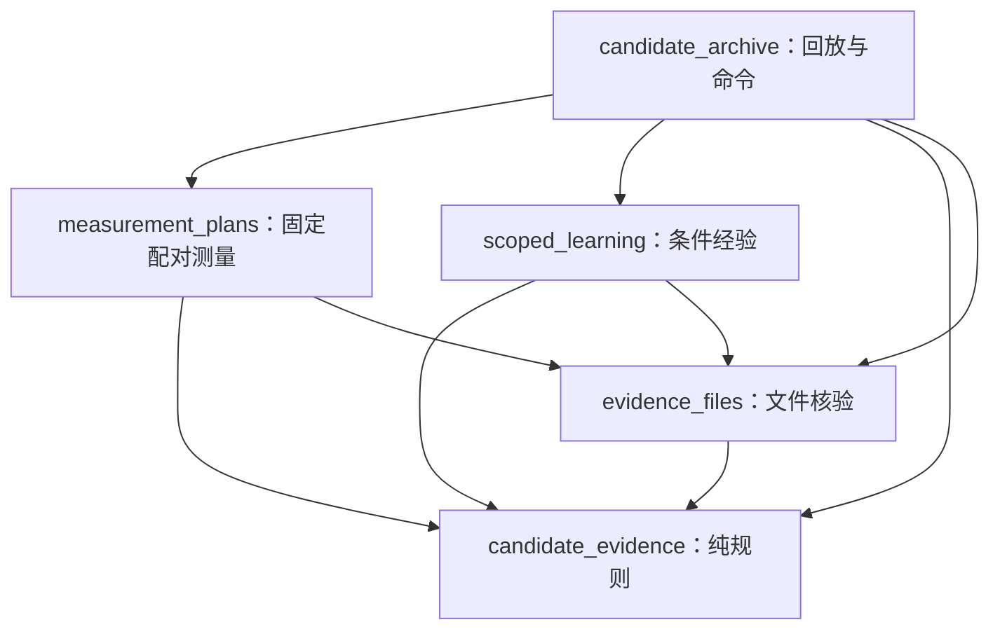

# 候选证据与文件核验

候选身份、比较投影和文件核验原先集中在 `candidate_archive`，测量计划与条件经验
通过参数接收整个档案 module，再调用其中的规则。现在它们直接依赖两个具体的
module，调用方只传记录、比较条件和可选的单次文件读取视图。

## 纯规则 Interface

[candidate_evidence.py](../skills/competition-optimize/scripts/candidate_evidence.py)
提供共享错误类型、严格 JSON 解析、规范序列化与摘要，以及候选身份、观测资格和
`ComparisonEvidence` / `ComparisonView`。它不读文件，也不导入档案命令、测量计划
或经验模块。比较视图借用 records；视图存活期间，调用方不修改这些记录。

身份仍按源码或 recipe 区分实现，比较仍按完整契约分组、按首个合格观测确定代表。
重复测量的排名冲突只是重测依据，不产生新分数或自动晋升。

## 文件核验 Interface

[evidence_files.py](../skills/competition-optimize/scripts/evidence_files.py) 提供
`hash_path`、`verify_result`、`verify_artifacts` 和可选的 `EvidenceReads`。
它核对当前 result、源码或 recipe 的字节及已记录的实现复核；文件缺失和变更
继续按原错误路径上报。

`EvidenceReads` 只在一次操作中复用摘要，每次使用重新检查文件身份，最近写入
文件重新读取，目录每次重新枚举。不跨轮次保留摘要，也不缓存文件内容。

## 消费与兼容

`measurement_plans` 的计划验证、状态和摘要只用归档值；需要核验当前文件时，
由显式证据核验入口负责。`scoped_learning` 直接使用同一身份规则，检索时核验
被引用的实际文件，交付确认只检查最终包中完整保留的材料。

`candidate_archive` 继续直接导出迁出的名称，包括旧的私有观测 helper 别名。
旧导出与新入口指向同一实现；测量和经验函数的内部调用已移除整模块参数。
CLI、档案 JSONL schema 1、campaign schema 2 和旧 sealed turn 不需要迁移。

文件核验测试已迁到 `evidence_files`，观测规则测试直接使用 `candidate_evidence`。
两个新解释器消费测试分别验证真实测量计划和经验修订链，无需加载
`candidate_archive`；缺失文件不影响纯计划查询，显式文件核验仍会失败。
