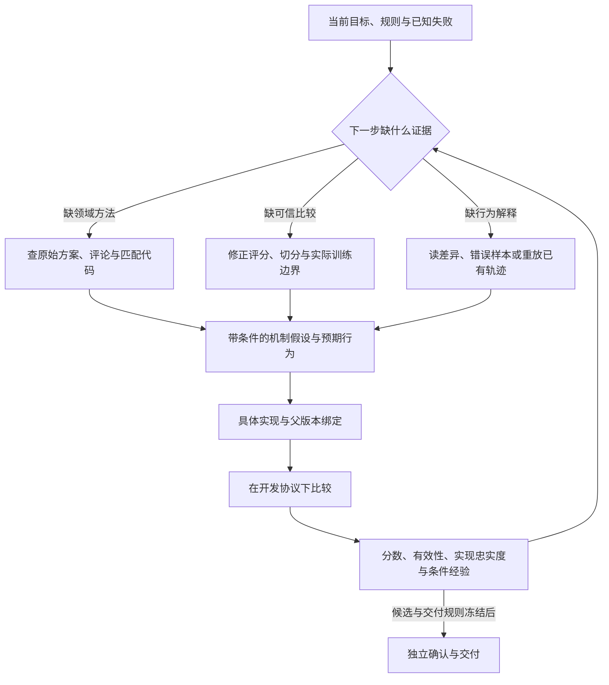

# 专业比赛 Skills 与 Agents 研究报告

2026-11-16。研究对象为已下载的 **12 个仓库、13 份固定版本快照**，以及当前 `competition-optimize`。研究目标是回答：这些项目有哪些实际机制，能够帮助我们更好地找资料、建立本地评测、避免公榜过拟合、按依据改进，并实现机制层面的提升？

对应的[改进方案](competition-improvement-plan-2026-11-16.md)已将下文建议细化为文件落点、实施顺序和验收方式。随后完成 A—C 阶段实现、离线验收及主要匿名读取链路的在线验证；新增工具、案例、真实接入修复与验证限制见[实施记录](competition-improvement-implementation-2026-11-16.md)。下文保留研究阶段的证据边界。

## 1. 主要判断

**最值得吸收的是几个具体的衔接机制：把专业资料读成可核查的依据，把验证协议落实到真实训练，把失败定位到状态和行为，再让结果改变下一次实现。** 本轮没有得到“某一个完整框架同时解决五个方向”的证据，也没有依据给这些项目排竞赛效果名次。

对当前仓库，最明确的增量是一个按研究问题调用的 **Kaggle 原始来源读取入口**：准确定位比赛和强队方案，读取正文与关键评论，取得对应版本的代码，保留截断、失败与缓存范围。现有 skill 已经规定这些研究动作，但提案的 `basis` 文本不会自动取得和核实外部证据。shepsci 与 NVIDIA 提供了可借鉴的具体读取路径。

本地评测仍是整个系统的基础。当前数值表格 adapter 已有真实逐折拟合、OOF、训练边界检查、冻结模型和独立确认接口；不能再把“增加真实训练循环”当成普遍缺口。图像、文本、特殊计分或远程训练，应等具体任务出现后补一个实际 adapter，复用现有合同。

理论分析能够省掉一部分无价值实验：例如证明一个改动不影响动作排序、发现最佳候选选择的控制流不等价于取最优、确认某个反思没有写回后续检索库。但理论分析通常不能证明一种新策略在真实目标分布上提分。报告将这两类结论分开。

## 2. 方法与证据边界

本报告沿实际调用链阅读 SKILL、提示词、检索客户端、训练与评测入口、候选选择、反馈和记忆写回，并抽读与关键保证直接相关的已有测试。**研究阶段没有运行上游程序、测试、训练、模型调用或比赛提交，也未修改实现。** 测试在本文中是被阅读的断言；后续新增读取工具的本地测试结果另见实施记录。

证据按三个层次使用：

| 层次 | 能支持什么 | 不能据此推出什么 |
| --- | --- | --- |
| 源码与配置事实 | 请求如何构造、何处 fit、分数由谁产生、默认是否启用、结果送到哪里 | 默认配置以外的所有运行、真实服务可用性、比赛收益 |
| 静态推导与理论判断 | 在明确前提下，排序是否改变、分支是否可达、比较是否有混杂 | 未知数据分布下的提升幅度 |
| 待验证效果 | 资料是否更有用、候选是否提分、总成本是否下降 | 本文不将其写成已证实结果 |

“有这个提示词”“实现了调用”“已有测试覆盖”“真实比赛有效”分别需要不同证据。配置关闭的功能可以是可选能力，不能描述成默认路径；演示 evaluator、候选自行打印的分数，也不能自动视为外部可信评分。

源码快照保存在 [下载目录索引](/data/lzh/downloads/competition-skills-agents-20261116/README.md)，完整版本和压缩包 SHA-256 在 [sources.json](/data/lzh/downloads/competition-skills-agents-20261116/sources.json)。下载的 8,585 个文件不是通读量；ADK 历史快照还包含大量 MLE-STAR 以外的示例。当前 skill 的比较基准是 `fde9ea880d2de2602d64ca10e730212ceb785303` 对应的代码，报告制作期间工作树另有文档改动。

## 3. 这些项目分别解决哪一段问题

它们处在不同层，直接比较“谁最强”会混淆职责。

| 项目 | 实际职责与最有价值的机制 | 采用时需要保留的边界 |
| --- | --- | --- |
| FrankS agentic-kaggle-skill | 验证先行、持久化划分、OOF/组合指导、远程日志脚手架 | fold 标签不包含全部训练边界；训练模板仍需实现 |
| NVIDIA nvidia-kaggle | 讨论抓取与缓存、递归回复、notebook 版本归档 | 搜索归属、缓存完整性与具体代码版本要分别核查 |
| shepsci kaggle-skill | 精确比赛 scope、榜单/team/writeup 关联、正文与评论读取 | fallback 不是获奖证明；服务端返回范围不等于全部历史 |
| claude-scholar | miner/learner 分工、跨比赛知识与带条件的失败经验 | 整理入库不等于核实；main/codex 工具依赖不同 |
| EvoMaster / ML-Master 2.0 | 方向规划、多个 idea、执行、逐轮知识提炼再研究 | 轮内反馈与跨任务入库不同；评分和 best 选择须单独审查 |
| RD-Agent | 可检验假设、继承代码、实现任务、diff/结果/失败反馈；可选重评 selector | 日常 runner、最终 selector、封存确认是不同层 |
| MLE-STAR 历史实现 | 实际网络搜索、候选运行、消融、定位代码块、按结果继续 refinement | 消融依赖程度不等于剩余改进空间；开发分数仍需可信边界 |
| HeurAgenix | 文献到操作的映射、跨问题迁移、好坏轨迹与状态重放 | 对照轨迹需先合法；允许调参，非强制机制改进 |
| SkyDiscover | 多类搜索、最优程序上下文、范式生成与资源分配 | 批次收益不是单想法贡献；搜索器不能补救错误 evaluator |
| LoongFlow | Planner→Executor→Summary、反思回流、数值采样权重 | 文本反思与数值权重是不同路径；公式依赖分数尺度 |
| ShinkaEvolve | setup/convert/run/inspect 入口、有效性包装、源码反馈包、成本核算 | 模板不会自动建立隐藏集；在途成本是估计 |
| ALE-Bench | 开发反馈与最终评价的调用顺序、判题与预算前缀评测 | benchmark 的测能力目的和比赛夺分目标不同 |

适合当前需求的组合关系如下；这是本报告的综合设计，不是某一个上游已经完整实现的架构。

独立确认结果若重新影响实现或候选选择，就已经参与开发，不能继续解释为未参与选择的独立证据。

## 4. 方向一：把查资料能力落到来源身份、完整阅读和迁移条件

### 4.1 检索要同时解决“在哪里找”与“凭什么采信”

shepsci 的榜单读取优先使用已发布 private board，否则使用 public board；通过 `teamId` 将 writeup 与真实排名关联。后备内容搜索带精确 `competitionIds`，结果明确标为 `source=content-search, rank=None`。这保留了“由排名关联发现”和“普通搜索线索”的不同含义。[榜单关联](/data/lzh/downloads/competition-skills-agents-20261116/shepsci-kaggle/skills/kaggle/modules/discussions/scripts/leaderboard_writeups.py:108)、[后备搜索](/data/lzh/downloads/competition-skills-agents-20261116/shepsci-kaggle/skills/kaggle/modules/discussions/scripts/leaderboard_writeups.py:411)。

NVIDIA 的讨论搜索先解析比赛标题，再按标题和比赛类型查询，搜索请求没有精确比赛 ID；解析结果却写入请求方的比赛 ID，并据此构造 URL。这构成条件风险：如果搜索命中其他比赛或相似标题，记录字段本身不能证明真实归属。本文没有调用 API，也没有观察到实际错归案例。[请求与解析](/data/lzh/downloads/competition-skills-agents-20261116/nvidia-kaggle/skills/nvidia-kaggle-skill/scripts/discussions/discussion_client.py:130)。

因此，排名适合安排阅读优先级，真实比赛身份和原文用于核实来源。高票讨论、非获奖者的反例、作者后续纠正，都可能提供当前最缺的信息。不能把“只找高排名”写成唯一入口，也不能因搜到帖子便为它补造排名。

### 4.2 完整阅读要能看见尚未读到的部分

shepsci 将列表预览与正文读取分开。writeup 阅读器支持原始 Markdown、HTML 转换、来源标识与外链，默认输出会提示文本截断，`--max-chars 0` 可取消显示截断。讨论阅读器保留主帖，评论与嵌套回复按显示预算输出，并提示剩余评论、回复和被截字符。[writeup reader](/data/lzh/downloads/competition-skills-agents-20261116/shepsci-kaggle/skills/kaggle/modules/competitions/hackathons/scripts/fetch_writeup.py:97)、[讨论正文与评论](/data/lzh/downloads/competition-skills-agents-20261116/shepsci-kaggle/skills/kaggle/modules/discussions/scripts/forums.py:324)。

需要区分三个范围：本地显示是否截断、上游本次返回多少、哪些请求失败。`--full` 可以展示本次服务端载荷，不能证明所有历史评论均已返回。

NVIDIA 的缓存减少重复抓取，但当前 ingest 只在已有 body 为空时填入详情正文；评论读取异常会打印后继续，抓取时间在逐帖详情读取前设置。因此 `last_fetched_at` 不能证明正文和纠正评论都已刷新。本地搜索也只查 title/author/body，不搜索评论正文，更不会因零命中自动扩大远端召回。[ingest](/data/lzh/downloads/competition-skills-agents-20261116/nvidia-kaggle/skills/nvidia-kaggle-skill/scripts/discussion_ingest.py:46)、[本地查询](/data/lzh/downloads/competition-skills-agents-20261116/nvidia-kaggle/skills/nvidia-kaggle-skill/scripts/discussions/database.py:152)。

对比赛工作流，读取的停止条件应是当前问题已有足够证据。若关键争议还在未读评论中，就继续展开；若已有正文和匹配实现已经回答问题，就不必默认抓完全部讨论。

### 4.3 成绩必须和产生它的实现版本对应

NVIDIA 的 `kernel_read.py` 会忽略 URL 中的 `scriptVersionId`、读取 latest，并给出提示；另一个归档模块才支持列版本、读取各版本公榜分数、下载指定版本代码。两条路径不能混用。[latest 行为](/data/lzh/downloads/competition-skills-agents-20261116/nvidia-kaggle/skills/nvidia-kaggle-skill/scripts/kernel_read.py:59)、[版本归档](/data/lzh/downloads/competition-skills-agents-20261116/nvidia-kaggle/skills/nvidia-kaggle-skill/scripts/kernels/archive.py:266)。

解释历史强方案时，应优先读取作者所引用的版本。自动挑选 best public version 只能说明它在该公开比较中的位置，不能证明该版本泛化最好。无需为解释一篇方案默认扫描全部历史版本。

### 4.4 从资料提取的应是条件化机制

一条可用研究结论至少需要回答：原方案修复什么失败，使用了什么信息，改变了什么行为，依赖哪些数据和训练条件，当前实现缺哪一部分，什么现象会支持或反驳迁移。MLE-STAR 的检索结果 schema 主要保存模型名与示例代码，未要求来源 URL、commit 和成绩依据；当前 skill 的来源链要求可以补足这一层。[检索接线](/data/lzh/downloads/competition-skills-agents-20261116/mle-star-historical/python/agents/machine-learning-engineering/machine_learning_engineering/sub_agents/initialization/agent.py:342)、[当前研究要求](/data/lzh/workspace/projects/competition-agent-skill/skills/competition-optimize/references/competition-research.md:23)。

Scholar 的 miner/learner 适合组织跨比赛线索与 root cause/workaround，但知识笔记仍需回源。抽读的 AIMO 笔记对 GRPO 展开不一致；Konwinski 笔记以同一组 `scores` 的 `max(scores) < percentile(scores)` 表达拒绝，在正常有限数值和常规百分位定义下该条件无法成立。这是派生笔记示例的问题，没有证据归因给原参赛代码。[AIMO 两处之一](/data/lzh/downloads/competition-skills-agents-20261116/claude-scholar-codex/skills/kaggle-learner/references/knowledge/nlp/aimo-2-2025.md:208)、[另一处](/data/lzh/downloads/competition-skills-agents-20261116/claude-scholar-codex/skills/kaggle-learner/references/knowledge/nlp/aimo-2-2025.md:1016)、[拒绝示例](/data/lzh/downloads/competition-skills-agents-20261116/claude-scholar-codex/skills/kaggle-learner/references/knowledge/nlp/konwinski-prize-2025-6th-place-study.md:185)。

适合迁移的是“线索→原文→实现→适用条件→当前机制缺口”。批量入库、摘要数量和 Top20 覆盖率都不能替代这个过程。

### 4.5 更强检索应围绕当前不确定性扩大搜索

比赛强解的作用，是提供已经被别人探索过的结构和实现线索，帮助缩小当前需要自己探索的空间。但迁移是否合理，要比较目标、信息边界、数据结构、资源和配套训练；比赛名称或 embedding 相似度只覆盖其中一部分。

| 当前缺的认识 | 优先查什么 | 读取后应得到什么 |
| --- | --- | --- |
| 不知道本地验证为何和目标不一致 | 官方规则/计分、测试生成方式、赢家的验证与榜单分歧讨论 | 可解释的切分与计分假设，而非仅复制 KFold 配置 |
| 已发现某类错误，缺少修复方法 | 本赛完整方案与评论、相同数据结构的相邻比赛、相关论文实现 | 针对失败类型的表示、目标或推理机制及必要条件 |
| 有一个方法名，但不知具体实现 | 原作者代码、匹配版本、训练与推理设置 | 能落实到当前父代码的完整改动范围 |
| 方案看似有效，但有争议 | 作者回复、失败复现、勘误与替代解释 | 支持条件和反例，明确哪些结论尚不能迁移 |

HeurAgenix 的跨问题迁移提示先映射 solution/operator，再要求解释原问题与目标问题的差异，体现了“按结构迁移”的方向；它并不证明模型给出的映射一定正确。[组件映射](/data/lzh/downloads/competition-skills-agents-20261116/heuragenix/src/problems/base/prompt/mapping_component_in_heuristic.txt:1)、[跨问题迁移](/data/lzh/downloads/competition-skills-agents-20261116/heuragenix/src/problems/base/prompt/transfer_heuristic.txt:1)。

因此检索失败应驱动换查询角度或资料层级，而不是重复同一个关键词。衡量检索能力时，应看它是否找到可回查的关键证据、排除了错误解释、改变了机制决策；来源更多和排名更高都只是中间信号。以上是设计判断，本轮没有测量检索召回或决策收益。

## 5. 方向二：本地评测质量首先取决于它在估计什么

### 5.1 分数稳定不等于评测正确

为解释问题，可以把一个候选的本地分数概念性地写成：

$$
\widehat U(f)=U_{\mathrm{target}}(f)+b_{\mathrm{metric,split,information}}(f)+\varepsilon(f).
$$

这里的偏差项包含官方计分与本地计分不一致、训练/目标分布不匹配、实体或时间边界错误、信息泄漏等；随机项描述训练与抽样波动。这是分析分解，不能仅凭一个分数识别各项大小。

增加 seed 或 fold 主要帮助认识随机波动。它不能修复错误计分、未来标签泄漏，也不能保证一个与目标不同的划分有代表性。因此，在昂贵复测前，应先回答：真实预测发生时有哪些信息？目标是新实体、未来时段还是同分布样本？官方按行、组、题目还是查询聚合？训练内学得的预处理是否跨过了边界？

### 5.2 时间 fold 标签不足以表达训练过程

FrankS 的 `make_folds.py` 确实生成分组或时间划分，但输出循环只保留 `valid_idx` 对应的 fold ID，丢弃 `train_idx`；同时给出 group/time 时，auto 优先 group。训练脚手架仍是待实现入口。[输出逻辑](/data/lzh/downloads/competition-skills-agents-20261116/franks-agentic-kaggle/scripts/make_folds.py:319)、[训练模板](/data/lzh/downloads/competition-skills-agents-20261116/franks-agentic-kaggle/scripts/scaffold_competition.py:70)。

由此可以静态推出一个条件结论：若下游消费者在时间任务中直接用 `fold != k` 作为第 k 折训练集，就可能用后期数据预测早期验证。本文没有执行或观察到上游发生该泄漏。时间任务应保存或重建每次实际训练前缀、标签可用时间和必要间隔；实体与时间均约束信息时，两者必须共同落实。

当前 `tabular_training.py` 已显式消费 `train_ids/validation_ids`，检查 OOF 覆盖，每折新建模型，只用该折训练行调用 `fit`，再对验证行预测，保存模型与 receipt。相关测试还读取保存的 StandardScaler，检查样本数和均值确实来自该折训练行。[真实训练](/data/lzh/workspace/projects/competition-agent-skill/skills/competition-optimize/scripts/tabular_training.py:205)、[拟合状态测试](/data/lzh/workspace/projects/competition-agent-skill/skills/competition-optimize/tests/test_tabular_training.py:76)。

这是值得保留的已有实现。其保证仍有范围：支持有限数值输入、标量回归/二分类及指定无权指标；候选 Python 在主机进程导入执行，接口本身不是操作系统沙箱，也不能证明上游特征从未使用未来信息。[支持范围](/data/lzh/workspace/projects/competition-agent-skill/skills/competition-optimize/scripts/tabular_training.py:89)、[边界检查](/data/lzh/workspace/projects/competition-agent-skill/skills/competition-optimize/scripts/tabular_training.py:128)。

### 5.3 要分别检查分数产生、传输和选择

EvoMaster 的 ImproveExp 会运行代码，由 Metric Agent 从 stdout 提取最终验证分数。RD-Agent 日常 runner 运行候选并检查其 `scores.csv` 与提交格式，再将 diff、代码、结果交给反馈模型。这些机制可以减少执行和格式错误，但候选分数的内容仍依赖其验证实现。[EvoMaster 评估入口](/data/lzh/downloads/competition-skills-agents-20261116/evomaster/playground/ml_master_2/core/exp/improve_exp.py:119)、[RD runner](/data/lzh/downloads/competition-skills-agents-20261116/rd-agent/rdagent/scenarios/data_science/dev/runner/eval.py:82)。

**RD-Agent 另有可选 `ValidationSelector`，不能把整个仓库说成没有重新评分。** 它构造共用的新划分和 `grade.py`，重跑候选，按重评分数选解。默认最终 selector 则是 `GlobalSOTASelector`，两者不能混为默认行为。新划分如果被用于比较和选择，承担的是开发选择角色；即使名称叫 validation/test，也不自动构成独立确认。[重评 selector](/data/lzh/downloads/competition-skills-agents-20261116/rd-agent/rdagent/scenarios/data_science/proposal/exp_gen/select/submit.py:264)、[默认配置](/data/lzh/downloads/competition-skills-agents-20261116/rd-agent/rdagent/app/data_science/conf.py:119)。

这里还有具体信息边界：数据生成提示将新 test 标签保存为同一 input 目录的 `label.csv`，候选重跑挂载的也是这份目录；`grade.py` 的 metric 依照参考代码生成。已读实现没有封存这些标签，也不能由分数输出格式正确推出 metric 符合官方定义。另外，默认 GlobalSOTA 沿 trace 取最近 `decision=True` 的节点，不应仅按名字解释成全历史数值最优。[标签与 scorer 提示](/data/lzh/downloads/competition-skills-agents-20261116/rd-agent/rdagent/scenarios/data_science/proposal/exp_gen/select/prompts.yaml:92)、[实际重跑](/data/lzh/downloads/competition-skills-agents-20261116/rd-agent/rdagent/scenarios/data_science/proposal/exp_gen/select/submit.py:560)、[trace 选择](/data/lzh/downloads/competition-skills-agents-20261116/rd-agent/rdagent/scenarios/data_science/proposal/exp_gen/base.py:267)。

FrankS 的远程日志模板也说明状态语义的重要性：默认示例写假 submission、记录 `placeholder_metric=0.0, stage=smoke`，然后 finish。可借其指标、异常和产物回传方式，但不能把 finish 当真实训练和计分已完成。[默认运行块](/data/lzh/downloads/competition-skills-agents-20261116/franks-agentic-kaggle/scripts/prepare_kaggle_kernel.py:140)。

### 5.4 便宜的诊断和代表性比较回答不同问题

一个重放状态可以判断新规则是否改变预期动作；小样本可以暴露崩溃或明显信息越界；已有 OOF 可以分析错误集中在哪些实体。这些证据能决定修实现、放弃机制或继续比较，却通常不足以给完整方法排名。

若以后确需比较 A/B，优先使用相同评价单位。对于可写成单位差值均值的比较，在这些单位相互独立的简化前提下：

$$
\operatorname{Var}(\overline{A-B})=
\frac{\sigma_A^2+\sigma_B^2-2\operatorname{Cov}(A,B)}{n}.
$$

两者表现正相关时，配对有助于减少比较方差。时间或实体相关任务的单位应是适当的块或组，不能把相关行当成独立样本夸大把握；AUC 等非逐行可加指标不能直接套用这个均值公式，仍须遵循实际聚合。缓存输出也只适用于能由这些输出回答的问题：例如已有预测可用于组合诊断，不能证明新训练特征或新搜索策略的效果。

## 6. 方向三：避免把公榜与本地开发集都优化成答案

### 6.1 择优本身会偏向噪声

考虑一个说明性模型：预先给定 M 个真实质量相同的候选，每个本地分数误差均值为零，且满足参数为 $\sigma^2$ 的 sub-Gaussian 上界。对任意 $t>0$，有：

$$
\mathbb E\max_i\varepsilon_i
\leq \frac{\log M}{t}+\frac{t\sigma^2}{2}
\quad\Rightarrow\quad
\mathbb E\max_i\varepsilon_i\leq\sigma\sqrt{2\log M}.
$$

推导来自 $\max_i x_i\leq\log\sum_i e^{tx_i}/t$、Jensen 不等式和各误差的矩母函数界；该上界不要求误差相互独立。它说明即便没有真实提升，反复取最大值也可能选中正噪声。

这不是现实自适应比赛的偏差校正公式：真实候选质量不同，候选还会根据已有反馈生成，$\sigma$ 也未知。它支持的结论较窄但重要：**控制公榜反馈之外，还应识别本地开发选择的乐观偏差。** 单纯把所有选择搬到同一个本地集，不能消除这种现象。

### 6.2 独立性由反馈方向决定

ALE-Bench 的入口先进行 public 采样选择和 self-refinement，再生成固定预算前缀的候选，最后统一 private 评价；self-refinement 使用 public feedback，未通过判题记最差分。这是实际调用顺序提供的边界。[主流程](/data/lzh/downloads/competition-skills-agents-20261116/ale-bench/src/ale_bench_eval/__main__.py:123)、[refinement](/data/lzh/downloads/competition-skills-agents-20261116/ale-bench/src/ale_bench_eval/scaffolds.py:406)。

应吸收的是“开发结束后再看最终评价”。这里的 public/private 是 benchmark 内部角色，不能仅按名字等同 Kaggle 公榜/私榜。其按 median 选择 repeated sampling 的选项服务于能力评测，也不是比赛夺分时通用的最优策略。[选择策略](/data/lzh/downloads/competition-skills-agents-20261116/ale-bench/src/ale_bench_eval/selection.py:75)。

当前工作流已规定确认集不参与开发决策。后续需要守住的实际动作是：先固定候选与交付规则，再确认；若看完确认结果决定改动，就应将它记为已参与开发，不能沿用“独立”解释。不存在靠换文件名、换一次随机划分就恢复独立性的做法。

### 6.3 公榜分歧应产生可核查的问题

若本地提升、公榜下降，先区分抽样波动、目标分布、计分聚合、训练/推理差异、输出对齐和信息边界。一次公榜变化不能唯一识别原因。公榜能提示失配，却不足以直接证明某个特征、seed 或混合权重更优。

历史获奖排名与当前公榜还有不同用途：前者帮助寻找值得阅读的方案，后者是当前选择过程的一次反馈。引用历史强解不会直接造成当前公榜过拟合；根据少量当前榜分反复改实现，则会把榜单纳入开发。

因此不建议设定一个未经任务依据支持的“安全提交次数”。更实用的是在获取反馈前写清它要区分的解释，以及不同结果将改变什么行动；如果各种可能结果都不改变下一步，这次反馈的信息价值就很低。

## 7. 方向四：让依据、实现与结果共同约束下一步

### 7.1 研究循环有价值的部分是反馈接线

三个 ML agent 的值得借鉴之处，可以落实到具体数据如何流动：

| 项目 | 实际反馈链 | 对当前工作流的启发 |
| --- | --- | --- |
| RD-Agent | 当前 best/失败历史→问题与假设→实现 task→继承父代码→diff、分数或异常→历史 | 保留一个核心可检验概念，允许为实现它做必要协同修改 |
| MLE-STAR | 实际搜索→候选运行→消融→定位原代码块→多个计划→按实测改进与耗时构造下一提示 | 让执行结果决定继续改哪段、怎样改，而不是每轮重新泛泛头脑风暴 |
| EvoMaster | 本轮多个方向/idea→运行结果与采用标记→knowledge promotion→下一轮 ResearchExp | 成功与失败必须重新进入后继研究上下文 |

这些链分别见 [RD proposal](/data/lzh/downloads/competition-skills-agents-20261116/rd-agent/rdagent/scenarios/data_science/proposal/exp_gen/proposal.py:1184)、[RD 失败与反馈](/data/lzh/downloads/competition-skills-agents-20261116/rd-agent/rdagent/scenarios/data_science/loop.py:211)、[MLE 后继计划](/data/lzh/downloads/competition-skills-agents-20261116/mle-star-historical/python/agents/machine-learning-engineering/machine_learning_engineering/sub_agents/refinement/agent.py:182)、[EvoMaster 知识回流](/data/lzh/downloads/competition-skills-agents-20261116/evomaster/playground/ml_master_2/core/playground.py:315)。

一个可判断的提案应包含：已观察到的缺陷或来源依据；当前父实现；要改变的信息或决策；必要的协同部分；预期出现的行为；不同结果分别意味着修实现、改假设还是放弃。不是要求增加一套新表单，当前 `basis/change/expected_observation/validation` 已能表达这些内容。

“一次一个核心概念”也不等于“一次只能改一个参数或一个文件”。例如改变训练目标可能必须同步修改数据组织、损失计算和推理输出。把必要耦合拆成残缺候选，会测到实现缺失；把多个互不依赖的想法捆绑，则会失去可解释性。

### 7.2 消融的价值与剩余潜力是两个问题

MLE-STAR 真的执行消融、读取结果并定位源代码块，后续计划还会看到以往的提升量和执行时间。这比仅让模型宣称“这里是瓶颈”更具体。[消融到计划](/data/lzh/downloads/competition-skills-agents-20261116/mle-star-historical/python/agents/machine-learning-engineering/machine_learning_engineering/sub_agents/refinement/agent.py:141)。

但删除组件造成的损失：

$$
D_i=L(f_{-i})-L(f)
$$

与替换该组件可能取得的最大收益：

$$
R_i=\sup_g\{L(f)-L(f_{i\leftarrow g})\}
$$

不是同一个量。一个关键组件可能已经接近可实现的最好状态，删除损失大而剩余空间小；一个目前未被充分利用的能力，删除影响小，重新设计却可能打开新空间。组件交互还会让单独删除更难解释。

所以消融适合回答“当前系统依赖什么、改动需保留什么”。寻找下一改进点还需结合目标分布中的失败、已知强方案的能力差距、实现成本和可改变的行为。不能按消融损失机械地分配后续全部预算，也不应把消融设成每个候选的固定前置成本。

### 7.3 一个 best 选择问题足以说明外围正确性的重要性

EvoMaster 固定方向起点 baseline，之后按 idea 顺序处理结果；每个成功且超过 baseline 的候选都会覆盖 `direction_best`，没有在此处和已更新的方向 best 比较。若越大越好，baseline=0.70，两个成功候选依次为 0.80、0.75，这条控制流最后留下 0.75。[具体循环](/data/lzh/downloads/competition-skills-agents-20261116/evomaster/playground/ml_master_2/core/playground.py:274)。

这是静态控制流推演，没有运行示例，也不证明实际比赛已发生退化。它说明一件可直接迁移的事：假设生成再复杂，评分方向、有效性和真正的最优选择仍应由清楚的程序语义承担。超过起点、被接收、是当前最好，分别是不同状态。

当前仓库已把实现复核与成绩分开：复核报告绑定提案、执行后代码与 recipe，描述实际机制和缺失组件；评分仍来自评测。测试还专门区分“偏离提案但得分高”和“实现忠实却退步”。因此需要沿用这条链，不能让解释写得好就自动晋级。[实现复核](/data/lzh/workspace/projects/competition-agent-skill/skills/competition-optimize/scripts/implementation_reviews.py:50)、[独立性测试](/data/lzh/workspace/projects/competition-agent-skill/skills/competition-optimize/tests/test_implementation_reviews.py:211)。

### 7.4 总结进入上下文、被采用和跨任务学习有不同保证

EvoMaster 的入口从本地 `example_wisdom` 做 top-1、阈值 0.7 的检索；普通逐轮总结进入下一轮。timeout 时提炼的 wisdom 在已读主链中只解析、返回和记日志，没有写回该检索库；正常结束路径也没有自动执行这次提炼。[prefetch](/data/lzh/downloads/competition-skills-agents-20261116/evomaster/playground/ml_master_2/core/exp/prefetch_exp.py:75)、[结束路径](/data/lzh/downloads/competition-skills-agents-20261116/evomaster/playground/ml_master_2/core/playground.py:334)、[wisdom 返回](/data/lzh/downloads/competition-skills-agents-20261116/evomaster/playground/ml_master_2/core/exp/wisdom_promotion_exp.py:71)。

当前 `scoped_learning` 已保存条件、限制、下一步和实测来源，绑定比较身份与证据 hash，支持显式修订；后继提案可通过 `learning_from` 引用当前有效结论。它比单独保存总结文本更接近可追溯学习，但哈希只保证证据身份，agent 报告仍需语义判断。[学习验证](/data/lzh/workspace/projects/competition-agent-skill/skills/competition-optimize/scripts/scoped_learning.py:60)、[后继引用](/data/lzh/workspace/projects/competition-agent-skill/skills/competition-optimize/scripts/scoped_learning.py:108)。

跨比赛经验应先作为新研究线索，重新检查条件；不能直接把其他 comparison 的分数当成本任务证据。没有必要为了“有记忆”另建一个脱离当前候选档案的通用知识库。

## 8. 方向五：用行为变化定义机制改进

### 8.1 机制要能说明系统新增了什么能力

本报告将机制改进理解为改变系统如何获得或表示信息、允许哪些动作、优化什么目标、如何训练、如何分配搜索与如何选择结果。判断依据是可执行行为，而不是改动行数、提示词长度或有没有可调参数。

基于问题推导的校准、阈值或拟合参数可以是一个机制的必要部分；没有假设、只追开发分数或公榜变化的参数扫掠，仍不符合当前目标。新增函数若永远不被调用，或新项在所有动作比较中抵消，也没有实现声称的能力。

### 8.2 HeurAgenix：从失败终局追到可改变的状态

HeurAgenix 将同一实例的好坏轨迹、终局、分数与代码送入瓶颈识别，再重放负轨迹前缀，恢复操作前状态，提出该状态下的修改。提示词还要求排除等价操作和不影响最终成本的差异，寻找最早引起后续问题的步骤。[状态恢复](/data/lzh/downloads/competition-skills-agents-20261116/heuragenix/src/pipeline/heuristic_evolver.py:233)、[瓶颈识别要求](/data/lzh/downloads/competition-skills-agents-20261116/heuragenix/src/problems/base/prompt/identify_bottleneck.txt:27)。

这个机制的价值在于把“结果不好”转换成“在这个状态忽略了什么信息、选错什么动作”。有已有轨迹时，可先利用它提出和排除解释，减少直接重跑完整求解的次数。

仍有两个重要限制。第一，好轨迹未必只因一个动作更好，重放只能提供局部诊断。第二，该版本扰动选正例时只比较更好分数，忽略了 `run(env)` 返回的完整性与有效性；部分解的低成本不能作为好终局。移植前必须保留任务合法性条件。[扰动筛选](/data/lzh/downloads/competition-skills-agents-20261116/heuragenix/src/pipeline/heuristic_evolver.py:195)、[返回值含义](/data/lzh/downloads/competition-skills-agents-20261116/heuragenix/src/pipeline/hyper_heuristics/perturbation.py:21)。

### 8.3 一个无需训练即可判断的 JSSP 例子

已读进化启发式对每个未完成 job 计算：

$$
s_j=\max(t_{\mathrm{machine}(j)},t_j)-\frac{w}{d+1},
$$

其中 $w$ 和 $d$ 对当前状态下所有 job 相同。因此在通常精确算术意义下：

$$
\arg\min_j s_j=\arg\min_j\max(t_{\mathrm{machine}(j)},t_j).
$$

该统一偏置不会改变排序，调它也不能实现按轨迹偏好选择不同 job；函数的 docstring 已明确承认这个 offset 不改变顺序。[进化启发式](/data/lzh/downloads/competition-skills-agents-20261116/heuragenix/src/problems/jssp/heuristics/evolved_heuristics/shortest_processing_time_first_d471.py:53)。

相对基础版，真正的机制变化是从“下一工序处理时间最短”变为“机器和 job 最早就绪”。例如构造一个状态，A 下一工序耗时 1、就绪时间 100，B 耗时 10、就绪时间 0：两种规则会选不同 job。此例仅说明决策差异，不证明哪种规则使完整 makespan 更优。[基础版排序](/data/lzh/downloads/competition-skills-agents-20261116/heuragenix/src/problems/jssp/heuristics/basic_heuristics/shortest_processing_time_first_c374.py:23)。

这正是理论分析可以节省测试成本的地方：先证明新项是否能改变相关行为，再决定剩余的性能问题是否值得付费验证。不需要给一个代数上抵消的参数做大规模搜索。

### 8.4 搜索调度可以创造机会，但收益归因需要具体比较

SkyDiscover 用当前最优代码、评价文本和已试想法生成新范式，实施时又选择当前最优父程序，结合兄弟候选和错误上下文。这有助于让改进基于可见实现，但“生成时的 best”和“实施时的 best”可能不同，不等于冻结了父代码身份。[范式生成](/data/lzh/downloads/competition-skills-agents-20261116/skydiscover/skydiscover/optimize/search/adaevolve/controller.py:340)、[实施上下文](/data/lzh/downloads/competition-skills-agents-20261116/skydiscover/skydiscover/optimize/search/adaevolve/controller.py:505)。

其数据库区分本岛新获得的收益和迁入成果，迁入不领取本岛 UCB 奖励，这是明确的归因设计；但范式 tracker 将整个批次期间的 best-score 总增量赋给每个用过的范式。后者可以作为调度记忆，却不能解释为每个想法的独立作用。[迁入处理](/data/lzh/downloads/competition-skills-agents-20261116/skydiscover/skydiscover/optimize/search/adaevolve/database.py:463)、[批次归因](/data/lzh/downloads/competition-skills-agents-20261116/skydiscover/skydiscover/optimize/search/adaevolve/paradigm/tracker.py:244)。

LoongFlow 则把父子代码与评价生成的 reflection 保存进 solution summary，下次规划读取所选父项 JSON。数值权重另按 `parent_weight + 3*score_diff*step_size + 3*child_score` 计算，并非 reflection 文本直接决定。公式包含原始子分数，评分尺度变化会改变调度，退步子代也不保证比父项权重低。[summary 两条路径](/data/lzh/downloads/competition-skills-agents-20261116/loongflow/agents/math_agent/summary/summary_agent.py:218)、[进入规划](/data/lzh/downloads/competition-skills-agents-20261116/loongflow/agents/math_agent/planner/plan_agent.py:112)。

对当前系统，适合吸收的是：提案绑定实际父版本、记录候选相对于谁改变了什么、将可支持的条件结论送回下一步。没有证据表明需要先迁移岛模型、特定系数或整个进化数据库，才能完成这些改进。

## 9. 如何在不启动昂贵实验的前提下改进决策

### 9.1 先准确理解“成本”

搜索轮数不是完整成本。一个候选可能附带检索、embedding、规划、编码、失败重试、训练、评价和反思；并行降低等待时间，也可能增加总计算量。比较时应分开记录 API 费用、GPU/CPU 时间、墙钟时间和提交次数，不能将不同单位直接相加。

ShinkaEvolve 已有较细成本核算：汇总生成、embedding、novelty、meta、失败尝试及 prompt evolution，并按“已知成本＋活跃 proposal 数×历史平均 proposal 成本”估算 committed cost。无历史时在途估计为零；到达阈值后，主循环还会等待在途工作完成。因此它比仅看已完成账单更完整，但不是严格费用上限，也不是全部训练计算成本。[成本汇总与在途估计](/data/lzh/downloads/competition-skills-agents-20261116/shinkaevolve/shinka/core/async_runner.py:843)、[停止后的等待](/data/lzh/downloads/competition-skills-agents-20261116/shinkaevolve/shinka/core/async_runner.py:2329)。

SkyDiscover 的 EvoX 还会在 solution iteration 之外生成 variation operators、演化搜索策略，因此相同 solution iteration 数不意味着相同 API 或总成本。LoongFlow 在没有配置 token 单价时可记出零费用，这不能解释为真实零开销。[EvoX 元搜索](/data/lzh/downloads/competition-skills-agents-20261116/skydiscover/skydiscover/optimize/search/evox/controller.py:178)、[LoongFlow 定价回退](/data/lzh/downloads/competition-skills-agents-20261116/loongflow/src/loongflow/framework/pes/pes_agent.py:539)。

对当前需求，成本分析的直接作用是减少无决策价值的操作，而不是引入更多自我优化层。没有资料证明某个复杂调度器一定比当前路由更省钱。

### 9.2 理论与源码审查能排除哪些方向

| 可以先做的分析 | 能得到的结论 | 不能代替的判断 |
| --- | --- | --- |
| 化简排序、损失或选择公式 | 新项是否抵消、是否真的改变动作或目标 | 改变后在目标分布上是否更好 |
| 追踪数据、分数和代码版本 | 信息是否越界、分数是否对应实际实现 | 原数据分布是否代表未来 |
| 追踪调用与写回 | 机制是否执行、经验是否进入后继、分支是否可达 | agent 是否真正理解并有效应用 |
| 阅读已有失败与状态轨迹 | 哪些解释与观察矛盾、哪里可能缺失能力 | 完整策略的平均收益与长尾风险 |
| 阅读必要的已有测试断言 | 已明确保证什么、有哪些构造边界 | 本轮测试通过、线上服务或竞赛效果 |
| 对比复杂度与信息需求 | 必要成本、资源瓶颈、推理时信息是否可用 | 常数开销和真实运行时间 |

这里有一个重要的不对称：理论可以证明某个“改进”没有改变相关行为，从而停止该方向；当理论只说明一种新机制有可能改善行为时，不能把“可能”升级成提分结论。尚缺真实结果的性能问题应保留为未决，不必为了写完报告而强行测试。

### 9.3 已读测试给出了哪些正面工程证据

本轮并非只找限制，也检查了与关键保证直接相关的测试：

| 项目 | 实际读到的断言 | 证据强度 |
| --- | --- | --- |
| shepsci | 不同顺序的 team/board 正确 join，fallback 带比赛 ID，截断和剩余回复可见 | 固定响应上的身份与输出语义测试 |
| RD-Agent | 重评分数输出解析、grade 脚本及缓存修复检查 | 另见 ML 分报告中的具体范围；不证明标签封存 |
| SkyDiscover | 同 seed 的采样流一致，archive/adapter 共用数据库 RNG | 不应依据旧注释称该版本没有 seed 支持 |
| ShinkaEvolve | 迁移/复制程序的副本不重复携带成本，原程序保留账目 | 成本核算的具体防重断言 |
| 当前表格 adapter | 保存的 scaler 只看训练折，OOF/时间边界、冻结副本有断言 | 对真实拟合边界的测试设计，非本轮执行结果 |

出处：[shepsci join 测试](/data/lzh/downloads/competition-skills-agents-20261116/shepsci-kaggle/tests/unit/test_discussions_leaderboard_writeups.py:98)、[RD 输出与缓存测试](/data/lzh/downloads/competition-skills-agents-20261116/rd-agent/test/scenarios/data_science/test_secure_parsing.py:16)、[采样可复现测试](/data/lzh/downloads/competition-skills-agents-20261116/skydiscover/tests/search/test_seeded_reproducibility.py:50)、[副本成本测试](/data/lzh/downloads/competition-skills-agents-20261116/shinkaevolve/tests/test_island_copy_costs.py:48)、[当前训练测试](/data/lzh/workspace/projects/competition-agent-skill/skills/competition-optimize/tests/test_tabular_training.py:76)。这些测试均未运行。

## 10. 与现有 skill 比较：真正的增量在哪里

### 10.1 五个方向已有的覆盖

| 用户方向 | 当前已有能力 | 本报告识别的增量 |
| --- | --- | --- |
| 更会查资料 | 按缺口 Search→Read→Pivot，要求原文、纠正、代码版本和条件，研究结果进入机制提案 | Kaggle 专业来源的操作入口与可见读取范围 |
| 高质量本地评测 | 机制探针/代表性比较/独立确认分工；数值表格真实 fold-fit-OOF-freeze | 实际非表格、特殊 metric 或远程任务出现时补对应 adapter |
| 不拟合公榜 | 公榜分歧进入诊断，确认集不参与开发，交付前冻结规则 | 严格按已有规则解释反馈，不新增一个“防过拟合 agent” |
| 有依据改进 | basis/change/预期观察/验证；执行后实现复核；失败与条件经验 | 用来源正文和已有轨迹使依据更具体，身份核验不冒充语义核验 |
| 机制改进 | 按缺口路由研究、诊断或实现，默认完整机制而非无依据调参 | 加强行为层解释，区分等价变化、真实能力与不可识别的收益归因 |

当前依据：[研究路由](/data/lzh/workspace/projects/competition-agent-skill/skills/competition-optimize/references/decision-loop.md:1)、[本地评价](/data/lzh/workspace/projects/competition-agent-skill/skills/competition-optimize/references/local-evaluation.md:1)、[研究到提案](/data/lzh/workspace/projects/competition-agent-skill/skills/competition-optimize/references/competition-research.md:37)、[proposal 的实际校验](/data/lzh/workspace/projects/competition-agent-skill/skills/competition-optimize/scripts/candidate_archive.py:278)、[经验链](/data/lzh/workspace/projects/competition-agent-skill/skills/competition-optimize/scripts/scoped_learning.py:60)。

### 10.2 第一优先级：专业来源读取的窄入口

这里的优先级指当前技能建设的增量；具体比赛若评测不可信，仍应先按既有路由修复评测。

建议未来实现一个可选读取入口，服务当前研究问题，复用现有 `basis` 与研究记录：

1. 用真实 competition scope 发现讨论，按 board/team 关系定位 writeup；普通搜索保留 fallback 身份。
2. 按需读取正文、纠正评论与指定 notebook 版本，输出真实 URL/ID、排名来源及版本。
3. 明确正文截断、剩余评论、服务端返回范围、失败与缓存状态；用于提案时保存原始快照身份。
4. 把证据转为现有格式的机制提案，说明当前父实现缺失什么和预期行为，不增加第二套候选系统。

这项增量直接对应用户最重视的资料能力，不需要 GPU。未来验收也应先围绕来源是否准确、纠正是否可读、版本是否匹配；无需先花训练成本证明接口能读取原文。真实服务访问、维护成本和最终比赛收益仍未实测。

### 10.3 当下可用的分析方法：先问什么证据会改变决策

先利用已有材料进行机制推导、实现追踪和必要的轨迹诊断。能静态排除的无效项直接排除；能从已有输出判断的失配就不重新训练；涉及新训练行为或新搜索路径、而当前无结果的问题，明确保留为待验证。

这是一种按决策选择证据的方法，不是固定的“先小跑、再多 seed、再大跑”流程。若只是研究方案，交付到可实施且理由完整的机制说明即可；用户授权实做后，再执行能回答剩余问题的适当验证。

### 10.4 条件性优先级：一个真实任务的执行 adapter

仅当下一场比赛超出现有数值表格或其它已有 adapter 的范围时，补一个实际执行入口。它应保留真实训练与验证索引、训练内学习的预处理、代码和 recipe、checkpoint/OOF、官方计分聚合、阶段与资源回传，并接入既有冻结/确认规则。[已有 adapter 合同](/data/lzh/workspace/projects/competition-agent-skill/skills/competition-optimize/references/adapter-contract.md:106)。

不要先抽象成覆盖图像、文本、LLM 和分布式训练的统一框架，也不需要默认移植所有上游 agent。当前阶段新增完整进化系统或泛化知识库，会增加维护与调用成本，但本轮没有找到其能解决额外已知缺口的证据。

## 11. 结论的适用范围与后续未决问题

本报告的确定结论是实现与理论层面的：哪些链路已接通、哪些保证只是模板或可选路径、哪些改动在数学上等价、哪些反馈能支持下一次决策。采用建议基于这些边界及当前 skill 的已有能力。

仍未回答的效果问题包括：专业读取入口能提高多少有效资料召回、节省多少上下文或人工时间；来源转化的机制能否在特定比赛上提分；复杂搜索调度是否值回其元搜索成本。这些问题需要真实任务资料或实测，继续阅读相似 README 无法解决。本轮不为此启动昂贵实验。

各项目也不是独立的疗效证据：提示词可能相互借鉴，同一竞赛知识会被多次整理，作者 benchmark 的设置与当前任务不同。本报告没有复现作者效果，没有把官方品牌、star 数、下载量或测试数量转换成实力排名。

## 附录 A：固定版本索引

表中 commit 为显示用缩写，完整值和下载 hash 见 [版本清单](/data/lzh/downloads/competition-skills-agents-20261116/sources.json)。这些结论只对应所读快照，不宣称是所有仓库的最新状态。MLE-STAR 使用历史官方实现。

| 本地目录 | 仓库 | commit | 仓库许可标识 |
| --- | --- | --- | --- |
| franks-agentic-kaggle | FrankS-IntelLab/agentic-kaggle-skill | `3cdd820356c8` | MIT |
| nvidia-kaggle | NVIDIA/nvidia-kaggle | `2b78cf29f5f3` | MIT |
| shepsci-kaggle | shepsci/kaggle-skill | `a47bff9830af` | MIT |
| claude-scholar-main | Galaxy-Dawn/claude-scholar | `d394fb599ed9` | MIT |
| claude-scholar-codex | Galaxy-Dawn/claude-scholar | `b672e80951a2` | MIT |
| evomaster | sjtu-sai-agents/EvoMaster | `50dc0000ebaf` | Apache-2.0 |
| rd-agent | microsoft/RD-Agent | `484776c211e4` | MIT |
| mle-star-historical | google/adk-recipes，原 adk-samples | `7d187b6f9752` | Apache-2.0 |
| heuragenix | microsoft/HeurAgenix | `e84bfb19e785` | MIT |
| skydiscover | skydiscover-ai/skydiscover | `0d932b690670` | Apache-2.0 |
| loongflow | baidu-baige/LoongFlow | `945c78bc1554` | Apache-2.0 |
| shinkaevolve | SakanaAI/ShinkaEvolve | `7ab55d7254d2` | Apache-2.0 |
| ale-bench | SakanaAI/ALE-Bench | `8ba16e6baf74` | 代码 Apache-2.0；数据另为 CC BY-ND 4.0 |

许可列是仓库级阅读索引；若未来复制具体代码或数据，按对应文件、数据和依赖的实际条款处理，不据这列概括所有内容。

## 附录 B：阅读记录与可追溯材料

- [前期收集清单](competition-skills-agents-2026-11-16.md)与[第一轮本地阅读摘要](competition-local-source-reading-2026-11-16.md)：项目发现、下载和初读背景。
- 第一轮逐文件范围：[skills](/data/lzh/workspace/outputs/competition-skill-research/20261116-local-reading/skills-reading.md)、[ML agents](/data/lzh/workspace/outputs/competition-skill-research/20261116-local-reading/ml-agents-reading.md)、[算法与评价](/data/lzh/workspace/outputs/competition-skill-research/20261116-local-reading/algorithm-reading.md)。
- 本轮进一步阅读：[专业来源与当前覆盖](/data/lzh/workspace/outputs/competition-skill-research/20261116-report/skills-deep-dive.md)、[ML 调用链与重评边界](/data/lzh/workspace/outputs/competition-skill-research/20261116-report/ml-agents-deep-dive.md)。
- [本轮关键证据索引](/data/lzh/workspace/outputs/competition-skill-research/20261116-report/report-evidence-index.json)：摘录、来源、位置与研究问题关联；其相邻 `.deep-research` 目录保留固定正文和研究状态。

本报告及索引是研究阶段交付；该阶段上游源码未执行，当前 skill 的实现未修改。后续授权实施的增量与验证另见[实施记录](competition-improvement-implementation-2026-11-16.md)。
