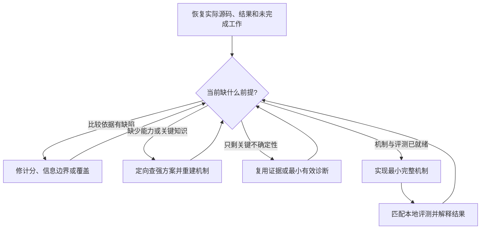

# 围绕五个方向的比赛工作流

目标是让每轮行动更可能带来有效能力，同时减少无法改变决策的执行成本。主流程按当前缺失的前提分流：资料决定值得构建什么能力，本地评测决定比较是否可信，机制假设决定具体改什么。五个方向进入日常决策，而不只是在开赛时检查一次。

## 主循环

先恢复正在运行或已经完成的工作，避免重复花费。无人值守中的执行修复、冻结测量计划优先处理。图中的分支按需进入；可信评测和已经理解的机制可以复用，不要求每轮重新检索或设计验证集。停止、确认和交付仍遵守用户范围与已有协议。

## 1. 资料检索直接参与路线选择

初次建立重要路线、强方案揭示能力差距、连续只剩相邻参数变化，或结果暴露具体知识缺口时，进入定向研究。先说明缺少哪个事实，以及不同答案分别会让下一步做什么；问题可以来自任务结构，也可以来自实际代码和开发记录。

围绕该问题主动查 Kaggle Discussions/Code、获奖复盘、原始论文和官方澄清，读完整原文、实质评论、修正和对应版本代码。查询词既包含当前瓶颈，也包含任务目标和另一种可能的表示，给更强的解法留出入口。

研究的产出是：**来源利用了什么任务事实 → 获得什么能力 → 当前实现缺什么 → 哪些组件必须一起实现 → 预期会出现什么本地变化**。只要缺失事实仍可能改变路线或必要组件，就继续追查；当机制与前提已清楚，剩余问题只是是否适用当前比赛，就转入实现。已有任务推导足以支持新机制时，也可直接实现。

沿用 `research.md` 与 proposal 的 `basis` 保存来源链和适用条件，不新增检索配额或研究完成证书。高公榜分、点赞和获奖名次用于发现线索；能否迁移由任务条件和本地证据判断。

## 2. 本地评测既要正确，也要能支持当前选择

评测首先对齐官方计分、实际输入输出、独立单位、信息可用时间和资源约束，再覆盖相关测试条件。比如测试新用户还是已知用户的未来行为，会导出不同划分；重复标识本身不能决定必须采用哪种方案。

分清三个用途，避免一次便宜诊断承担它无法支持的结论：

| 评测用途 | 输入与产出 | 改变的决策 |
| --- | --- | --- |
| 正确性／机制探针 | 官方例子、手算反例、缓存输出或具体轨迹 → 计分边界正确，或预期行为发生／未发生 | 修实现、补组件或推进原型 |
| 有代表性的开发比较 | 完整候选、匹配 workload／划分及资源 → 实际目标与分场景表现 | 选择候选，保留有价值的权衡 |
| 独立确认 | 提前冻结的候选与交付规则 → 未用于开发的结果 | 按冻结规则交付 |

发现计分错误、泄漏、错误独立单位、关键场景缺失或不真实的执行路径时，返回评测设计。更多 seed 和小数位不能消除这些系统性偏差。若只是随机排序不确定，而且会影响当前选择，才进入已有的配对测量流程。

评测修订要有独立的任务、数据或实现依据，在查看新排序前说明理由，保留旧身份，并在同一合法新协议下重建受影响的必要对照。独立研究或原型工作可以继续；不把评测修复扩展成必须重跑全部历史。

## 3. 公榜分歧触发诊断

正式提交仍需授权。提交前保留候选的机制依据、预期效果和可比本地结果。公榜与本地不一致时，先保留本地选择依据，检查计分约定、预处理、失败／超时处理、泄漏、覆盖、合理分布差异和抽样波动；需要外部事实时定向查官方澄清与验证讨论。

诊断应返回一个有依据的评测修复，或一个可反驳的迁移机制假设。原因不明时保留不确定性，继续有本地依据的工作。不能因为某次公榜更高，就挑选更能复现该排序的 folds、权重、prompt 或 seed。开发集同样会被反复使用所适应，因此冻结后的独立确认仍有必要。

## 4. 提案和反馈形成可以检验的推理链

在已有 proposal 中写清：**依据 → 限制或机会 → 能力变化 → 预期本地观察 → 可能失败的条件 → 能改变决策的比较**。依据可以来自任务推导、已核查资料或开发证据，不要求三者同时具备，也不要求新机制先证明提分。

先用界限推导、反例、源码和现有产物排除明显无效或重复的动作；需要执行才能回答的问题，留给有明确用途的执行。理论可以解释上限和适用前提，收益幅度仍需实测。

结果回来后，后继由预期与实际的差异决定：

| 结果 | 后继 |
| --- | --- |
| 机制没有实际发生 | 检查翻译错误、执行路径与缺失耦合组件；决定是否修复 |
| 机制发生，但完整目标没有改善 | 重审资料的迁移条件、收益代价或目标能力；选择另一机制或路线 |
| 候选排序尚不明确 | 只补充能够改变选择的匹配证据 |
| 在可比目标下改善 | 按协议选择候选；后续投资仍取决于尚存机会 |

有效低分、执行失败和测量不确定性分别记录。反馈引用实际结果并连接具体后继，防止每次失败都退回调一个常数。

## 5. 用能力边界选择机制改进

优先改变信息获取、表示、训练信号、目标、构造、选择或交互控制，使系统能完成当前做不到的决策。改动规模由机制需要决定：局部修正可以改变关键能力，大规模重写也可能只是重排同一种方法。必要参数随机制设置；专门参数搜索仍需用户明确要求。

例如，在候选池固定、选择器只能返回池内答案时，最终正确率不超过池中正确答案覆盖率。若正确候选经常存在却没选中，可研究归一化、验证和选择；若正确候选根本不存在，单改投票规则受覆盖上限约束，应考虑生成或监督。两类后继需要不同资料和代码改动。

若强方案的选择能力依赖匹配训练数据、答案归一化和选择器，应实现能够体现该能力的最小完整组合。只复制最后一个组件得到低分，不能据此否定整条路线。定向探针可以检查机制是否发生，候选晋升仍依据代表性的完整目标。

## 落地范围与成本

入口和恢复路由负责选择行动；资料与评测指南负责对应分支；campaign 的 work/rethink/execute 提示使用同样的分流和反馈规则。沿用现有 proposal、card、archive 与测量计划。可选 `working_selection` 单独记录当前采用候选及其依据，不改变原始目标分数或停滞统计；具体接口见 [campaign policy](campaign-policy.md)。

Runner 继续按真实档案统计执行进展。一次有依据的研究／评测前置工作可以先于实现，但记录本身不计作新实现，也不会重置停滞信号。它校验身份与证据连续性，不能自动证明评测代表性或机制价值。

本次通过 22 项本地检查：提示渲染 4 项、campaign 策略 9 项、指令快照与恢复 4 项、模拟 CLI 集成 5 项；另通过 skill 结构校验、123 个相对链接／锚点检查和差异格式检查。模拟集成覆盖提示交接、停滞计数和冻结测量计划，未启动比赛训练、模型推理或效果对照。以上是决策流程的设计改进，比赛收益尚无本轮实测结论。
